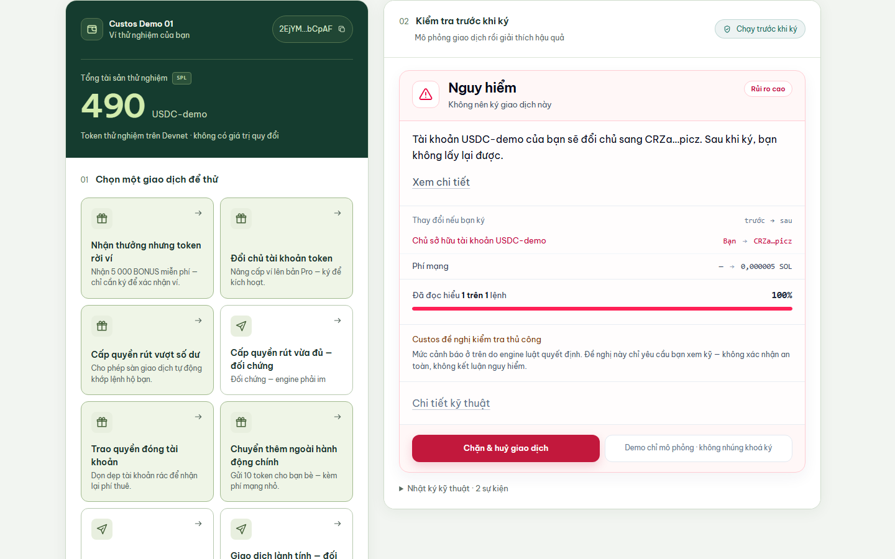
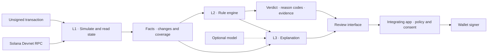

<div align="center">


# Custos

### Understand what you are about to sign.

A pre-signing transaction analysis SDK for Solana wallets and dApps.<br>
**See asset changes. Understand the permissions you grant. Check the evidence.**

[](https://github.com/NeitLN/Custos-Solana/actions/workflows/deploy.yml)
[](LICENSE)


[**Open the demo**](https://custos-sdk.vercel.app) · [**Try it as a user: SolBonus**](https://solbonus.vercel.app/nhan-thuong) · [**Integration page**](https://custos-sdk.vercel.app/tich-hop) · [**SDK**](packages/core/README.md) · [**Docs**](docs/README.md)

</div>

---

## The balance has not changed. Control may already have.

A transaction does not have to move tokens right away to create risk. In the owner-change case the team set up on Devnet, the account still holds **490 tokens**, but the simulation shows that ownership of the token account would move to another address if the transaction were executed.

**Custos brings those changes to the moment before signing.** The wallet or dApp calls the SDK; the user gets the asset changes, the permission changes, the reasons for the warning and the coverage of the analysis. The underlying facts can be opened for further checking.

<p align="center">
  <a href="https://custos-sdk.vercel.app/vi">
    
  </a>
  <br>
  <em>Screenshot from a local demo session connected to Devnet. Simulation only; no transaction was signed or sent during the recording.</em>
</p>

> **Devnet test build.** Simulation results depend on the available facts, chain state and supported scope. No red flags is not a guarantee of safety.

## Try it in 2 minutes — no install, no keys

**Custos lives inside the wallet, not on a link-scanning page.** Any dApp requests a signature through the Wallet Standard. A wallet that integrates Custos simulates **that exact transaction**, explains the consequences and lets the user decide before the wallet signs ([ADR-0004](docs/adr/0004-custos-trong-luong-ky-cua-vi.md)).

1. Open [SolBonus](https://solbonus.vercel.app/nhan-thuong) → **Connect wallet**. The Custos Wallet window pops up; click **Allow connection** and keep that window open.
2. SolBonus finds your DEMO tokens on Devnet by itself; then click **Claim 1,000 SOLB**. The Custos Wallet signing window simulates exactly the transaction SolBonus sent and shows **Danger**: half of the tokens leave, and the token account owner changes to another address.
3. Click **Block transaction** — SolBonus receives no signature.
4. Open the [Analysis Room](https://custos-sdk.vercel.app/vi) to compare the scenarios below, and the [Inspector](https://custos-sdk.vercel.app/inspector) to see 10 real mainnet transactions.

The full list of scenarios is in the [scenario registry](apps/demo-wallet/src/kichBan.ts).

| Scenario | What to look for |
|---|---|
| Token account owner change | Control changes even though no token has left the account |
| Approve 1,010 tokens, balance 490 | The over-balance rule fires |
| Approve 250 tokens, balance 490 | Control case: the over-balance rule does not fire; the signer's intent still needs review |
| Missing facts or RPC error | Shows a "could not fully check" state; the integrator must not fall through to signing |

## Every surface of the product

| You want to… | Open here |
|---|---|
| Understand the product before trying it | [About page](https://custos-sdk.vercel.app) |
| Try it as a user: a malicious dApp asks for a signature | [SolBonus, a SIMULATED malicious dApp](https://solbonus.vercel.app/nhan-thuong). Separate origin, does not call Custos, only connects to the wallet through the standard |
| See how to integrate and run the SDK function itself | [Integration page](https://custos-sdk.vercel.app/tich-hop) |
| Run the scenarios and read the results | [Custos Wallet](https://custos-sdk.vercel.app/vi) |
| Check any transaction (developer tool) | [Inspector](https://custos-sdk.vercel.app/inspector) |
| See Custos read **real mainnet transactions** | Inspector → section *Real mainnet transactions — replay*: 10 transactions recorded seconds after execution, replayed without network access. Recorded data, not a mainnet signing flow |
| See the numbers and what each one measures | [Evidence page](https://custos-sdk.vercel.app/so-lieu) · [Final acceptance](docs/review/ck-20261004/NGHIEM-THU-CUOI.md) |
| See a recording that does not depend on RPC | [Video: dApp → wallet → Block (50 s, subtitled)](docs/nop-bai/video/CUSTOS-LUONG-KY.mp4) · [Older video (before Wallet Standard)](docs/nop-bai/video/CUSTOS-DEMO.mp4) · [Submission pack](docs/nop-bai/README.md) |

Mirror on GitHub Pages: [neitln.github.io/Custos-Solana](https://neitln.github.io/Custos-Solana/). The older addresses `custos-solana.vercel.app` and `solbonus-custos.vercel.app/tan-cong/` still run in parallel.

The public build embeds no signing key. Whether the optional language model is active depends on each deployment's backend configuration: a real model run in a local recording does not mean every public demo has the model turned on. The interface shows where each explanation came from; when no model is used, a deterministic fallback explanation is shown.

## What does Custos do?

- **Consequence analysis:** reads balance, owner and delegate changes and other supporting facts from the simulation.
- **Warnings with reasons:** the rule engine returns a warning level, reason codes and the related evidence.
- **Says what it did not understand:** returns coverage and analysis limits so the user knows how far the result reaches.
- **Plain-language explanation:** Vietnamese or English (`locale: "vi"` / `"en"`), from deterministic sentences or an optional language model through an adapter. In `"en"` the explanation is always deterministic; the model path is not used.
- **Integration before signing:** the SDK serves wallet/dApp teams; the person who benefits is the one signing the transaction.
- **Inside the wallet's signing flow:** a Wallet Standard connector ([`packages/connector`](packages/connector/)) routes every dApp's `signTransaction` request into the wallet window. There Custos checks first, the user decides, and after the transaction runs the wallet compares the actual result with the prediction.

## Architecture: observe → evaluate → explain



| Component | Responsibility |
|---|---|
| [Core / L1](packages/core/src/l1/) | Simulates through RPC, extracts facts within the supported scope |
| [Core / L2](packages/core/src/l2/) | Applies the rules to produce `level`, reasons and evidence |
| [AI / L3](packages/ai/) | Explains the facts; deterministic sentences when no model is used |
| [Integrating app](vi-du-tich-hop/) | Displays, applies policy, obtains confirmation and checks the content before calling the signer |

**The AI does not create or modify `level`.** The boundary is enforced in the data contract, in how results are assembled and in output checks; it does not rely on the prompt alone. The explanation can still be wrong and needs to be evaluated separately.

**Why Solana?** Custos needs to understand the accounts, instructions and SPL Token permissions a transaction touches. Solana provides the state and the execution environment; Custos uses RPC simulation to observe before broadcast. The analysis runs off-chain; there is currently no Custos smart contract.

## Technical points worth a look

Each row points to a place in the code so you can check it yourself instead of trusting the description.

| Point | Where in the code | Check with |
|---|---|---|
| **Deterministic verdict.** `level` is produced only by the L2 rule engine; the data type L3 returns has no `level` field | [`l2/rules.ts`](packages/core/src/l2/rules.ts) · [`inspect.ts`](packages/core/src/inspect.ts) | `npm run check` |
| **Fail-safe.** A failed simulation, an account that could not be measured, or an unread instruction touching the signer's assets gives at least *Review carefully*, never `safe` | [`l2/evaluate.ts`](packages/core/src/l2/evaluate.ts) | [`failsafe.test.ts`](packages/core/test/failsafe.test.ts) |
| **Fenced AI.** Explanations pass an output checker; the AI cannot change the warning level, and there is a deterministic sentence when no model is used | [`packages/ai/src/moHinh.ts`](packages/ai/src/moHinh.ts) | [AI evaluation](docs/AI-EVALUATION.md) |
| **Checks exactly what the dApp sent.** The Wallet Standard connector routes `signTransaction` into the wallet window; the wallet simulates that very transaction before the user decides | [`packages/connector`](packages/connector/src/index.ts) · [`ket-noi.tsx`](apps/demo-wallet/src/ket-noi.tsx) | The SolBonus flow above |
| **Predicted vs. actual.** After signing on Devnet, the wallet compares the real on-chain changes with what Custos predicted | [`live/receipt.ts`](apps/demo-wallet/src/live/receipt.ts) | [Final acceptance](docs/review/ck-20261004/NGHIEM-THU-CUOI.md) |
| **Replay without network.** Saved RPC responses rerun L1 deterministically; mainnet is only a replay of recorded data | [`chay-replay.ts`](scripts/ky-thuat/chay-replay.ts) | `npm run replay-rpc` |
| **No leaked keys.** CI scans the bundle for API keys and URLs with credentials before every deploy | [`soi-ro-ri-khoa.mjs`](scripts/soi-ro-ri-khoa.mjs) · [`deploy.yml`](.github/workflows/deploy.yml) | Actions tab |

## Run locally

Use **Node 24.12.x** and **npm 11.6.2** as pinned in [.nvmrc](.nvmrc) and [package.json](package.json). On Windows, pick the Node version with whichever version manager you use; `nvm use 24.12.0` if you use nvm-windows.

```bash
git clone https://github.com/NeitLN/Custos-Solana.git
cd Custos-Solana
npx npm@11.6.2 ci
npx npm@11.6.2 run check # typecheck + 1456 tests
npm run vi
```

Open **http://localhost:5188**. In a second terminal, run the demo dApp page:

```bash
npm run tan-cong
```

Open **http://localhost:5189**. The Devnet setup addresses are already in [hien-truong.json](apps/demo-wallet/public/hien-truong.json); no model API key is needed to run the deterministic explanation path.

| Command | Purpose | Needs network? |
|---|---|---|
| `npm run check` | Typecheck and the test suite | Yes for a few CLI cases that call RPC; the rest run locally |
| `npm run replay-rpc` | Check L1 against saved RPC responses | No |
| `npm run doi-khang` | Adversarial probes | No |
| `npm run thu-tich-hop:deterministic` | Check the consumer with fixtures | No |
| `npm run mo-phong-kichban` | Simulate the scenarios on Devnet | Yes, RPC |
| `npm run thu-tich-hop:devnet` | Check a live integration run | Yes, RPC |
| `npm run thu-goi` | Pack the SDK and install it from outside the monorepo | Yes, npm registry |

Public RPC can be slow or rate-limited. A live run that fails on the network does not by itself prove the engine detected wrongly; check the cause and compare with the offline replay.

## SDK integration

Start from the [Core guide](packages/core/README.md) and the [sample consumer](vi-du-tich-hop/). The snippet below illustrates the analysis call, **not a complete signing flow**:

```ts
import { inspect } from "@custos-solana/core";
import { boiThoiHan, dienGiaiKhongAI } from "@custos-solana/ai";

// connection: a Devnet connection; transaction: the unsigned transaction.
// Take the user's address from the wallet; do not trust a value the dApp declares.
const result = await inspect(
  { connection, interpret: boiThoiHan(dienGiaiKhongAI) },
  transaction,
  { locale: "en", nguoiDung: walletPublicKey.toBase58() },
);
```

Before wiring this to a signer, the app must handle timeouts/errors, the warning level, `aiAdvisory`, coverage, and whether the transaction changed after it was checked. Do not sign automatically just because `result.level === "safe"`. See the [signing contract in the consumer](vi-du-tich-hop/src/ky.js) and the [threat model](docs/bao-mat/THREAT-MODEL.md).

## Technical evidence

The numbers below are a **stored snapshot**, not a promise of performance or accuracy on every transaction. Sources: [so-lieu.json](apps/demo-wallet/public/so-lieu.json), the [verification report](docs/BAO-CAO-KIEM-CHUNG.md) and the [dataset spec](docs/SEED-DATASET.md).

| Scope | Stored result |
|---|---|
| Rules in production | **14** — 12 from the spec, plus 2 rules that came out of the security audit |
| Tests | **1456**, run by `npm run check` |
| Samples in the dataset | **38** — all 14 rules have a triggering sample; **all 14 rules** also have a near-identical control case that differs only in the deciding condition |
| Real mainnet transactions, replayed | **10** consecutive successful SPL Token transactions, recorded on 2026-10-06 seconds after execution, not selected by outcome: **4** Normal (no flags in the parts we could read) · **6** Review carefully (**4** because the re-simulation failed — fail-safe, never returns `safe`) · **0** Danger. [Data](apps/demo-wallet/public/replay/mainnet.json) · [how it was recorded](scripts/capture-mainnet-phat-lai.ts) |

<details>
<summary><strong>Deep dive: evidence, performance and the scope of each measurement</strong></summary>

| Evidence | What it shows, and within what scope | Not yet shown |
|---|---|---|
| **1456 tests** automated | The behaviours and invariants in the test suite | Detection quality on real-world traffic |
| **38 samples** labelled | Triggering and control cases for the rules | Generalisation to an independent set |
| **Public cohort stored offline** | Behaviour on stored responses | Precision/recall; the cohort has no ground truth yet |
| **10 replayed mainnet transactions** | The engine reads real mainnet messages; when state is missing it says so instead of guessing | A signing flow or asset protection on mainnet; a detection rate — 10 samples, unlabelled |
| **Integration example** | A consumer built by the team uses the SDK from outside the monorepo | Adoption or third-party demand |
| **AI evaluation** — 13/13 traps blocked, 3/3 correct sentences passed | The guard set across stored adversarial cases; evaluated with a real model | That every explanation is correct or easier to understand than the template |

Rubric mapping per [ADR-0001](docs/adr/0001-doi-huong-technical-build.md); the weights are how that document organises the evidence, not scores awarded by the judges.

| Criterion group | Evidence and source |
|---|---|
| **30 %** difficulty and depth | **14** L2 rules · **1456** tests in the suite, a few CLI cases need RPC · [behaviour matrix](docs/bao-mat/MA-TRAN-HANH-VI.md) |
| **25 %** on-chain/off-chain architecture | L1/L2/L3; the engine owns the verdict, the integrating app owns signing; no dedicated contract yet |
| **25 %** Solana stack · performance | `inspect()` **639 ms** in the stored integration measurement; [RPC budget](docs/NGAN-SACH-RPC.md) |
| **20 %** demo and presentation | FCP **88 ms** · click→card **n=30**, median **890 ms**, observed p95 **6005 ms** · [environment and method](docs/HIEU-NANG.md) |

Interface numbers were measured on headless Chromium; do not extrapolate them to real devices or every browser.

| Measured on Devnet, 2026-09-25 — latest passing run | |
|---|---|
| Install → first result | **8.4 seconds** — median of 10 runs across 9 builds, range 6.6–13.2 |
| Lines of integration code | **31** |
| One check | **639 ms** — median of 10 runs across 9 builds |

This consumer was built by the team; the integration-friction measurement does not prove there is a customer or partner.

Measured, not estimated: **1456 tests** and **38 labelled samples** in the stored snapshot. These are scoped engineering checks, not an accuracy benchmark.

</details>

## Current limits

- **Devnet-only:** the runtime/demo is for testing; we make no claim of readiness to protect mainnet assets. The mainnet section in Inspector is recorded data replayed offline — the wallet opens no mainnet connection.
- **Incomplete read coverage:** the decoders and Token-2022 support are still limited. Coverage is the scope of the analysis, not a probability that the transaction is safe.
- **Simulation has limits:** it reflects only the facts it could observe; chain state can change before the transaction is sent.
- **The integration decides enforcement:** the SDK cannot force a consumer that deliberately ignores the result or signs different content.
- **AI is optional:** there is a deterministic fallback path; the team has no validated data yet to conclude that the AI improves user understanding.
- **No validated market evidence yet:** this README does not use interview numbers from historical documents as traction. No third party has a confirmed integration yet.

### Dependencies and safety

`npm audit` on 2026-10-09: **19 vulnerabilities — 19 high · 0 moderate · 0 critical** in the stored snapshot (the only critical one, `shell-quote`, was patched the same day). Most come in through the spike dApp `apps/thu-ket-noi`, which is not part of the deployed build — the path of each group is in [dependency handling](docs/PHU-THUOC.md).

See the [dependency check artifact](data/seed/lo-hong.json) for the packages and the measurement time; this is not a fresh audit result. Run `node scripts/do-lo-hong.mjs` to update the measurement. Read the [security docs](docs/bao-mat/) to understand the limits before integrating. Never put signing keys or API keys in a frontend, a screenshot or a public issue.

## Next steps

- Evaluate on an independent labelled set of transactions; measure missed cases and unnecessary warnings separately.
- Harden the endpoint, error handling and observability for live runs.
- Extend analysis to the cases that still lack evidence.
- Find wallet/dApp teams to trial an integration and verify how signers understand the warnings.

This is a development plan, not a pilot or partnership commitment.

## Repository map

```text
apps/
  demo-wallet/       Custos Wallet (reference wallet) and signing window, Inspector, website, Evidence page
  trang-tan-cong/    SolBonus — SIMULATED malicious dApp, requests signatures through Wallet Standard
packages/
  core/             Simulation, facts, rule engine and the inspect API
  connector/        Wallet Standard connector: routes dApp signing requests into the Custos Wallet window
  ai/               Deterministic explanation, model adapter and output checks
  types/            Shared data contract
vi-du-tich-hop/     Consumer that checks integration from outside the monorepo
scripts/           Testing, replay, benchmark and packaging
data/              Dataset and technical evidence
docs/              Specs, threat model, reports and pitch material (mostly in Vietnamese)
```

## Docs by reader

| Reader | Start from |
|---|---|
| Judges | [Index — section for judges](docs/README.md) · [Verification report](docs/BAO-CAO-KIEM-CHUNG.md) · [Submission pack](docs/nop-bai/README.md) |
| Wallet/dApp teams | [Core integration](packages/core/README.md) · [Sample consumer](vi-du-tich-hop/README.md) |
| Technical reviewers | [Core spec](docs/DAC-TA-CORE.md) · [Threat model](docs/bao-mat/THREAT-MODEL.md) · [Behaviour matrix](docs/bao-mat/MA-TRAN-HANH-VI.md) |
| Contributors | [Docs index](docs/README.md) · [Issues](https://github.com/NeitLN/Custos-Solana/issues) |

When reporting a bug, include the steps to reproduce, commit, scenario, environment and expected/actual result. Do not attach keys, access tokens or private wallet data.

<details>
<summary>Competition context and track history</summary>

Custos is developed for **UniHackfest 2026 · Best Technical Build**, a choice confirmed by the project owner. The track registered on the historical form of 24 Aug is **Best Product & Business**; we keep this so readers can tell the older submission apart from the current direction. See the [change-of-direction ADR](docs/adr/0001-doi-huong-technical-build.md) and the [round information](docs/cuoc-thi/THONG-TIN-VONG-HIEN-TAI.md) to cross-check the submission; do not infer the form's update status from this README.

</details>

## In short

**Custos is a pre-signing transaction-intelligence SDK for Solana wallets and dApps.** It simulates transactions, surfaces asset and permission changes, and returns rule-based findings with supporting evidence and analysis coverage.

A Wallet Standard connector puts Custos inside the signing flow: any dApp's `signTransaction` request opens the Custos Wallet window, which simulates that exact transaction before the user decides. Inspector also replays 10 real mainnet transactions recorded seconds after execution (offline, recorded data — not a mainnet signing flow).

The deterministic engine owns the verdict. An optional language model explains structured facts; a deterministic explanation path remains available. The integrating application handles policy, consent and signing. Current runtime and demo scope is **Solana Devnet**, with no Custos smart contract and no claim of complete threat detection or confirmed third-party adoption.

**We are building Custos for Solana wallet users so they can understand asset and permission changes before signing.**

---

Built by **Team Too Hard** · [MIT License](LICENSE)
